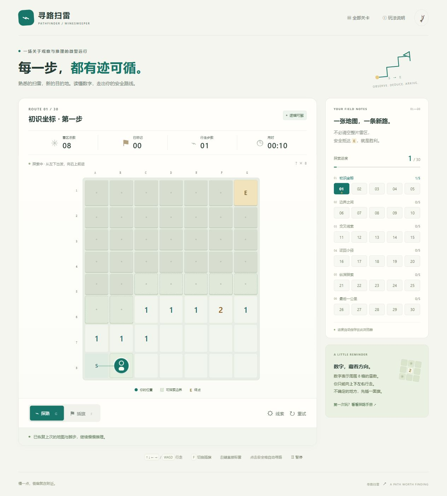

# 寻路扫雷

用经典扫雷数字，推理一条通往终点的路。独立设计、从零实现的 H5 逻辑小游戏，支持手机与电脑，无需安装或账号。

[GitHub 仓库](https://github.com/Reoxy258/mine-searcher) · [验证记录](docs/QA.md)



## 怎么玩

从矩形地图左下角 **S** 出发，安全抵达右上角 **E** 即可获胜，无需翻开所有安全格或标记所有地雷。

- 数字表示周围 **8 格**（含斜角）的雷数；零区域按经典扫雷规则自动展开。
- 只允许上下左右行走。点击与已连通安全区相邻的未知格，角色会先沿已知安全路线走到边界，再探索目标。
- 点击已打开的安全格可自动寻路；中间仍有未知格时无法跨越。展开的斜对角区域不允许直接跳过去。
- 起点周围与终点保证安全。看到 E 或自动展开 E 仍不算通关，需要真正走到终点。
- 切换插旗模式后点击未知格标记或撤销；电脑可右键直接标记。旗帜不等于确认有雷，已插旗格不能进入。
- 踩雷结束本关，展示雷区，可用同一张地图重试。星级纪录保留。

## 内容与推理保证

6 组 / **30 关**，地图从 7×8 增长到 11×14。全部关卡开放，可自由选择，不需要付费、网络请求或远程素材。

每关由固定种子的确定性生成器制作。候选地图必须先通过**可见数字约束推理 + 四向路线验证**才被采用；不是单纯保证存在一条无雷路线。推理使用已揭示数字、确定安全格、确定雷格和约束子集消元，不读取未知格的雷值。固定种子保证刷新、重试和存档恢复使用相同地图。

「线索」提供逻辑确定的安全格或雷格，不代替行走，不把玩家旗帜当作事实。错误旗帜若挡住已证明安全格，会提示撤销。无提示通关得 3 星，使用 1～3 次得 2 星，更多得 1 星；保留最高星级，步数与用时不影响星级。

## 操作

| 操作 | 电脑 | 手机 |
| --- | --- | --- |
| 探索 / 自动寻路 | 点击格子 | 轻点格子 |
| 相邻行走 | 方向键 / WASD | 点击相邻或边界格 |
| 插旗 | 右键，或 F 切换模式后点击 | 点「插旗」后点格子 |
| 纯键盘插旗 | F → 方向键选格 → Enter / 空格 → F 返回 | — |
| 只选择格子 | Shift + 方向键，Enter 操作 | — |
| 返回探路模式 | G / F / 探路按钮 | 探路按钮 |
| 暂停 | P / Esc / 暂停按钮 | 暂停按钮 |
| 大地图 | 正常显示 | 在地图内左右滑动 |

手机大地图保持约 32px 触控格，横向滚动限制在地图内部。音效默认关闭，使用 Web Audio 合成；未开启时无声音。弹窗与切后台停止计时。没有倒计时或强制速度要求。

浏览器本地自动保存当前地图、位置、旗帜、已开格、用时、提示次数和通关星级。存储不可用时仍可在本次会话游玩，并明确显示无法保存。

## 开发与发布

Node.js 22+，不需要安装依赖。

```sh
npm run dev
# http://127.0.0.1:4180
npm test
npm run build
```

构建产物位于 `dist/`，支持任何静态站点托管和 GitHub Pages 的仓库子路径。源码入口需要 HTTP(S)；构建还生成 `dist/standalone.html`，可以直接双击离线游玩。

独立 GitHub 仓库：`Reoxy258/mine-searcher`。在仓库 Settings → Pages 中选择 **GitHub Actions**，推送 `main` 后工作流先测试构建，再发布。PR 只运行测试构建。

| 文件 | 职责 |
| --- | --- |
| `src/engine.js` | 地图、推理、路径、行走、胜负、存档 |
| `src/levels.js` | 30 关参数与固定种子 |
| `src/app.js` | 输入、界面、声音、计时、弹窗协调 |
| `src/styles.css` | 独立响应式视觉与触控布局 |
| `tests/` | 两个验证 agent 的独立测试 |
| `docs/QA.md` | 验证范围与已知限制 |

制作分工：主 agent 独立实现；规则验证 agent 检查关卡与核心规则；界面验证 agent 审查输入、小屏和状态。问题由主 agent 统一修复。
