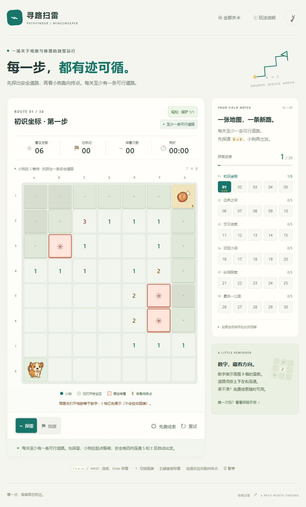
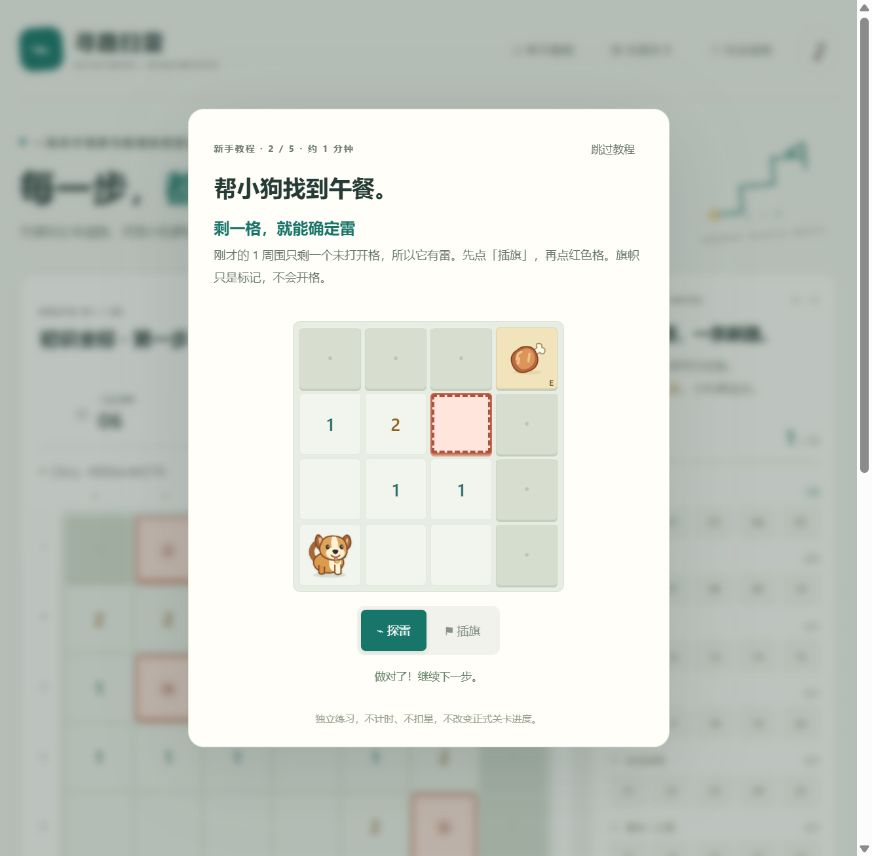

# 寻路扫雷 · 局部雷格提示版验证

2026-10-23。主 agent 制作，规则 agent 与界面 agent 独立验证。

## 自动验证

61 项测试全部通过：24 项基础规则、6 项最短路线与推理、7 项局部提示、11 项基础界面、7 项教程规则、6 项教程界面。

- 全部 30 关有真实四向安全路线，且能按可见数字推理通关，无需猜雷或保护。
- 300 个随机已开区域由独立搜索器核对最短步数与同长度下最少转弯；未知、插旗与斜向不能通行。
- 自动红色提示仅取单个已开数字周围八格：未打开格数量恰好等于原数字。角、边、多个符合线索的并集合并均有覆盖。
- 插旗格仍计入未打开格，不减旗；不做组合或连锁推理。用可被组合推理证明有雷、但局部不满足的棋盘，确认不会扩大高亮。
- 提示函数不修改游戏，不读取隐藏雷位或隐藏数字；渲染不自动插旗。主动免费线索中的雷格提示也采用局部条件，安全格线索保留。
- 已移除棋盘路线 SVG、连线、路线染色与数字高亮；小狗动画仍按真实格子坐标移动，覆盖嵌套偏移、分数像素与滚动。
- 轻松模式一次触雷保护、标准模式、存档恢复、误旗、终点孤岛、旧存档迁移和存储异常均有回归覆盖。

## 浏览器实际操作

- 首次进入显示五步互动教程：读数字、插旗、零扩散、免费提示、连接终点；错误格与错误模式不推进，不会失败。
- 教程实测完整走通，打开 E 后才跑步，结束后显示开始按钮；正式关卡探雷数、旗帜与用时保持不变。
- 完成后刷新不再自动弹出，顶部「新手教程」可重新从第一步开始；控制台无错误。
- 自动验证覆盖跳过、Esc 保存、焦点恢复、存储拒绝、动画取消和独立存档。小屏使用受限宽度与可滚动模态，未进行手机真机验收。

- 第一关前四次探雷，小狗留在 A8；第五次连通后按 13 格最短路线到 G1，之后才结算。
- 全程没有路线连线、路线染色或数字高亮；已插旗数保持 0，红色提示没有自动插旗。
- 完成后获得 3 星；控制台无错误。小狗、带骨肉与终点数字显示正常。
- 本轮未进行手机真机验收。

## 限制

固定 30 关，未实现无限随机模式。自动验证和浏览器关键流程不能代替全部关卡的真人难度测试。

