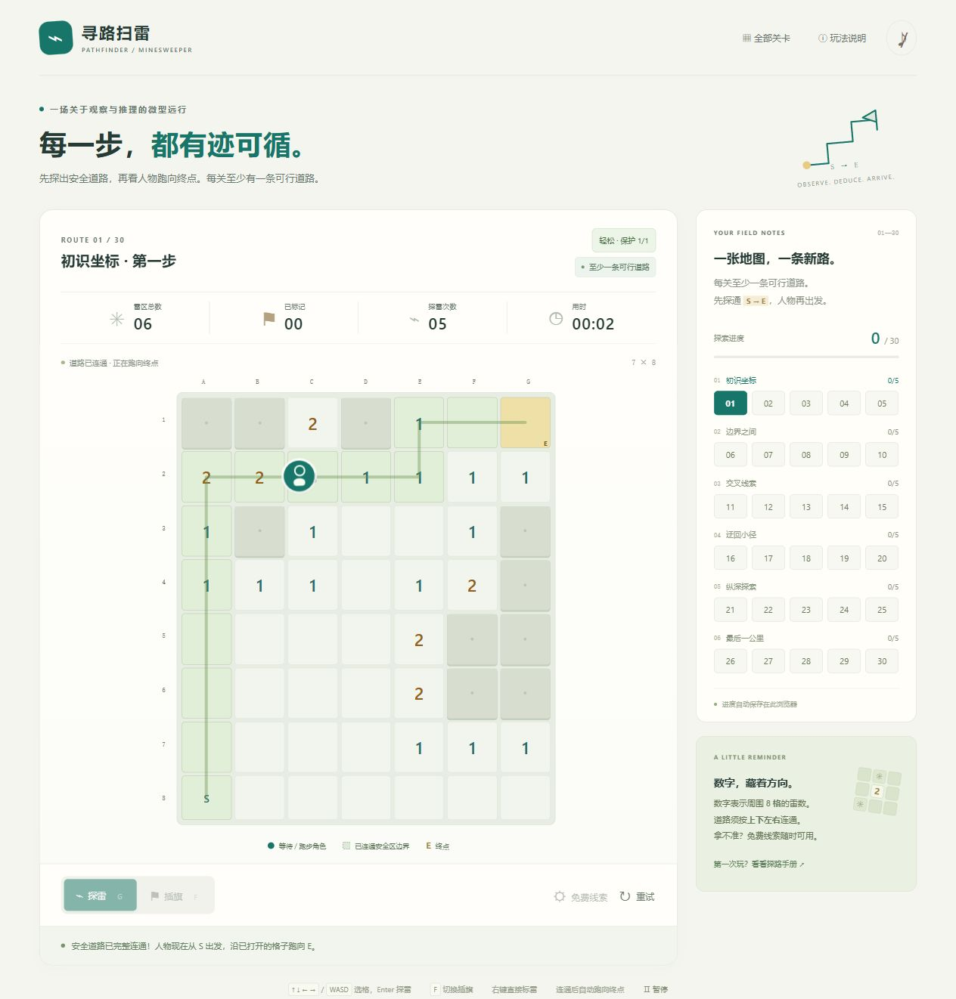

# 寻路扫雷 · 先探路再跑步版验证

2026-10-23。主 agent 制作，规则 agent 与界面 agent 独立验证。

## 自动验证

30 项测试全部通过：24 项规则、6 项界面。

- 30 关都有真实四向无雷路线，也全部能用可见数字推理通关，不依赖护盾或猜测。
- 任意未知格可以探雷；人物与足迹保持 S，只有完整已揭示路线出现才进入 running，finishRun 之后才 won。
- 终点孤岛、斜向连接、未揭示中间格和误旗均不能误触发通关。
- 轻松模式一次保护、自动标雷、保护耗尽后失败；标准模式首次触雷失败。保存恢复不能重新获得已消耗保护。
- 免费提示不影响星级，错误旗帜不当作事实。
- 前 10 关雷数下降且开局扩大；生成器排除开局直接连通的地图。
- playing / running / won / lost 四种状态保存恢复；旧存档保留星级并重开本关，损坏存档与存储异常降级。
- 静态节点、弹窗名称、规则文案与键盘选格一致；终点显示真实数字和 E 角标。

另外，仅按提示执行 safe / mine / unflag 操作，标准模式跑通 30 / 30 关，最多 55 次操作形成完整路线。

## 浏览器实际操作

- 第一关连续 4 次探雷人物保持 A8；第 5 次形成完整路线后才开始移动，结算面板在跑步中保持隐藏。
- 跑步中暂停，人物保持在同一格；继续后到达 G1 再结算。使用 5 次提示仍获 3 星。
- 模式切换取消时保留当前局，确认后重置为标准模式，探雷次数归零、人物仍在起点。
- 跑步中刷新，恢复后从 S 重新播放；跑步中重试后回到新局，旧动画没有继续写入位置或结算。
- 已保存跑步画面见下图。当前浏览器视口覆盖设置未实际切换到手机尺寸，因此本轮不声称新增手机真机验收；手机布局由界面 agent 代码审查，原有地图内横滑保留。

## 修复

界面 agent 发现终点 E 遮住已揭开的数字，但推理器使用该数字。现改为显示实际数字，E 缩为角标，并新增真实 renderBoard 回归测试。

## 限制

固定 30 关，未实现无限随机模式。自动推理及浏览器关键流程验证不能代替 30 关完整真人难度测试；未验证 iOS / Android 真机。

